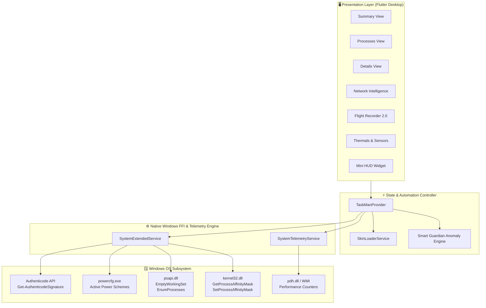

<div align="center">

# ⚡ TASKMAN ULTIMATE

### *Next-Gen Windows Telemetry & Advanced Process Forensics Workstation*

[-0078D4?style=for-the-badge&logo=windows&logoColor=white)](https://microsoft.com)
[](https://flutter.dev)
[-00E676?style=for-the-badge&logo=githubactions&logoColor=white)](https://github.com/sakfi/TaskMan-Ultimate)
[](https://github.com/sakfi/TaskMan-Ultimate/blob/main/LICENSE)

</div>

---

<p align="center">
  
</p>

> **TaskMan Ultimate** is an ultra-high-performance Windows desktop task manager, security forensics suite, and real-time hardware telemetry dashboard designed for enthusiasts, system administrators, and power users. Built entirely with Flutter Desktop and zero-overhead native **Win32 C-FFI bindings**.

---

## 🔮 Next-Level Feature Matrix

```
┌──────────────────────────────────┬──────────────────────────────────┬──────────────────────────────────┐
│ 🛡️ FORENSICS & SECURITY SUITE     │ ⚡ ENTHUSIAST HARDWARE CONTROL   │ 🌐 NETWORK INTELLIGENCE          │
├──────────────────────────────────┼──────────────────────────────────┼──────────────────────────────────┤
│ • File & Handle Lock Hunter      │ • EmptyWorkingSet RAM Compactor  │ • GeoIP & Cloud Provider Badging │
│ • Nuclear Process Tree Kill (/T) │ • CPU Core Affinity Bitmask Grid │ • Active Socket Inspector        │
│ • Authenticode Digital Signatures│ • Instant Turbo Power Plan Boost │ • Port Service Auto-Discovery    │
│ • VirusTotal Threat Intelligence │ • Precision Thermal Tracking     │ • Direct Remote Socket Disconnect│
└──────────────────────────────────┴──────────────────────────────────┴──────────────────────────────────┘
```

---

## 🌟 Core Superpowers

### 1. 🛡️ Deep Forensics & Process Investigation

* **Handle / File Unlocker**: Discover and terminate the exact process locking any file or directory handle without downloading third-party tools.
* **Process Tree Annihilator**: Nukes misbehaving process trees cleanly down to the leaf threads using native recursive termination (`taskkill /F /T`).
* **Authenticode Integrity Verification**: Inspects executable digital signatures and publisher certificates in real time.
* **VirusTotal Threat Intelligence**: Single-click SHA-256 hash / executable lookup against the global threat intelligence database.

### 2. ⚡ Enthusiast & Hardware Control

* **Instant RAM Working Set Compactor**: Evicts stale paging files and trims unreferenced memory working sets across every accessible process via `psapi.dll!EmptyWorkingSet`.
* **CPU Core Affinity Matrix**: Fine-grained per-core assignment modal allowing you to pin games, streaming software, or compile workloads to specific physical cores.
* **Turbo Boost Power Plan Switcher**: Instantly toggles between Windows High Performance and Balanced power schemes with one click.
* **Sub-Second Hardware Thermals**: Native real-time sensor polling for AMD Ryzen / Intel Core CPUs and NVIDIA / AMD Radeon GPUs.

### 3. 🌐 Advanced Network Intelligence

* **Autonomous GeoIP & Cloud Scope Resolution**: Automatically tags active connections with recognized cloud networks and boundary zones:
  * 🌐 `Cloudflare`, `Google WAN`, `Azure / MS`, `AWS Cloud`, `Akamai CDN`
  * 🔒 `LAN (Private)` (RFC1918), `Loopback`, and `Public WAN`
* **Port Service Profiler**: Auto-detects protocols (`HTTPS:443`, `DNS:53`, `SSH:22`, `RDP:3389`, `SMB:445`, etc.).
* **Active Socket Inspector**: Inspect ownership, copy remote IP/Port, and terminate owning processes directly from the network panel.

### 4. 🚨 Smart Guardian & Autonomous Anomaly Alerts

* Automated hardware safeguard watcher with dismissable banners and customizable threshold switches:
  * 🌡️ **Thermal Throttle Risk**: Triggers alerts if CPU or GPU exceeds 85°C.
  * 💾 **Low Working Set Warning**: Triggers alerts when physical RAM saturation hits 90%.
  * 🚀 **Sustained Workload Warning**: Warns when continuous CPU usage spikes over 95%.

### 5. 📊 Flight Recorder 2.0 (Black Box Telemetry)

* **Real-Time Rolling Telemetry Buffer**: Logs CPU, Memory, Disk I/O throughput, and culprit spike processes every second.
* **Interactive Timeline Scrubber**: Rewind and scrub back in time to inspect past hardware crashes or resource spikes.
* **Export Anywhere**: One-click telemetry dumping to formatted **CSV** and indented **JSON** datasets.

### 6. 🎨 Nostalgic & Cyberpunk Skin Engine

* Supports retro Windows Task Manager, Classic Winamp, Traces, Matrix Console, and custom `.tmogskin` themes with customizable fonts, meter styles, and neon palettes.
* Compact, floating **Mini HUD Mode** for monitoring hardware while gaming or compiling.

---

## 🏛️ System Architecture



---

## 🚀 Quick Start & Installation

### Option A: Pre-compiled Release Executable

Download or locate the standalone Windows executable:

```powershell
\TaskMan Ultimate\build\windows\x64\runner\Release\taskman_ultimate.exe
```

### Option B: Build from Source

Ensure you have the Flutter SDK (>= 3.24.0) and Visual Studio 2022 C++ Build Tools installed.

```powershell
# 1. Clone repository
git clone https://github.com/sakfi/TaskMan-Ultimate.git
cd TaskMan-Ultimate

# 2. Fetch dependencies
flutter pub get

# 3. Run unit & widget test suite
flutter test

# 4. Launch in development mode
flutter run -d windows

# 5. Compile optimized release bundle
flutter build windows
```

---

## ⌨️ Global Hotkeys & Shortcuts

| Shortcut | Action | Description |
| :--- | :--- | :--- |
| <kbd>Ctrl</kbd> + <kbd>F</kbd> | Search / Filter | Focuses process filter box |
| <kbd>Ctrl</kbd> + <kbd>R</kbd> | Refresh Now | Triggers immediate metric collection |
| <kbd>F5</kbd> | Force Sync | Polls full system telemetry and resets cache |
| <kbd>Ctrl</kbd> + <kbd>P</kbd> | Pause / Resume | Pauses telemetry polling to conserve CPU |
| <kbd>Del</kbd> | End Task | Terminates the selected process |
| <kbd>Shift</kbd> + <kbd>Del</kbd> | End Tree | Kills process and all spawned children |

---

## 🧪 Testing & Validation

TaskMan Ultimate includes comprehensive unit, service, and widget test coverage:

* **100% Passing Test Suite**: 12/12 unit and widget tests passing.
* **0 Analysis Warnings**: Verified with `dart analyze`.
* **Zero Runtime Leaks**: Fully isolated process execution checks.

```powershell
flutter test
dart analyze
```

---

## 📜 License

Distributed under the **MIT License**. Free for personal, commercial, and enthusiast use.

<<<<<<< HEAD

=======
>>>>>>> bcf535b (docs(readme): polish formatting, remove ASCII art, add support & connect sections)
## 💬 Support

If you encounter any issues or need help, feel free to:

<br>

<<<<<<< HEAD
- 🐛 Open an issue in this repository
- 💬 Reach out to me directly
=======
* 🐛 Open an issue in this repository
* 💬 Reach out to me directly
>>>>>>> bcf535b (docs(readme): polish formatting, remove ASCII art, add support & connect sections)

<br>

## 📱 Connect With Me

<br>

<div align="center">

[](http://t.me/SakFi)
[](https://github.com/sakfi)

</div>

<p align="center">
  
</p>
