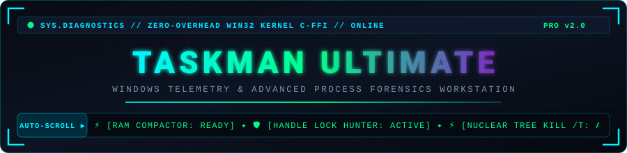
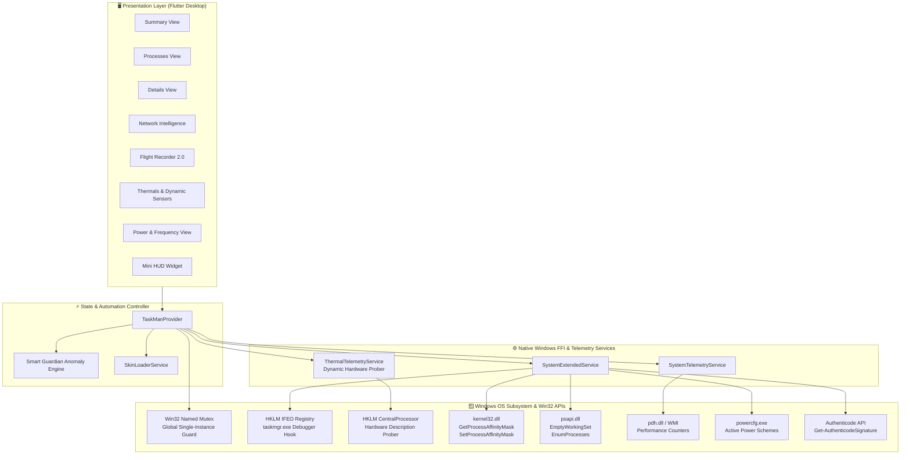

<div align="center">

# ⚡ TASKMAN ULTIMATE

### *Next-Gen Windows Telemetry, Hardware Forensics & Shell Workstation*

[-0078D4?style=for-the-badge&logo=windows&logoColor=white)](https://microsoft.com)
[](https://flutter.dev)
[-00E676?style=for-the-badge&logo=githubactions&logoColor=white)](https://github.com/sakfi/TaskMan-Ultimate/actions)
[](https://github.com/sakfi/TaskMan-Ultimate)
[](https://github.com/sakfi/TaskMan-Ultimate/releases/latest)
[](https://github.com/sakfi/TaskMan-Ultimate/blob/main/LICENSE)

</div>

---

<p align="center">
  
</p>

> **TaskMan Ultimate** is an ultra-high-performance Windows desktop task manager, security forensics workstation, and real-time hardware telemetry dashboard designed for enthusiasts, system administrators, and power users. Built with Flutter Desktop, zero-overhead native **Win32 C-FFI bindings**, dynamic registry hardware probers, and native Windows shell replacement hooks.

---

## 🔮 Next-Level Feature Matrix

```
┌──────────────────────────────────┬──────────────────────────────────┬──────────────────────────────────┐
│ 🪟 NATIVE SHELL REPLACEMENT      │ ⚡ ENTHUSIAST HARDWARE CONTROL   │ 🛡️ FORENSICS & SECURITY SUITE     │
├──────────────────────────────────┼──────────────────────────────────┼──────────────────────────────────┤
│ • 1-Click Taskmgr IFEO Takeover  │ • Dynamic CPU/GPU Auto-Detection │ • File & Handle Lock Hunter      │
│ • Named Mutex Single-Instance    │ • Real Hardware Base & Turbo Clks│ • Nuclear Process Tree Kill (/T) │
│ • Ctrl+Shift+Esc Focus Restore   │ • EmptyWorkingSet RAM Compactor  │ • Authenticode Digital Signature │
│ • Interactive Win32 UAC Elevation│ • CPU Core Affinity Bitmask Grid │ • VirusTotal Threat Intelligence │
├──────────────────────────────────┼──────────────────────────────────┼──────────────────────────────────┤
│ 🌐 NETWORK INTELLIGENCE          │ 🚨 SMART GUARDIAN MONITOR        │ 📊 FLIGHT RECORDER 2.0           │
├──────────────────────────────────┼──────────────────────────────────┼──────────────────────────────────┤
│ • GeoIP & Cloud Provider Badging │ • Autonomous Hardware Alarms     │ • Rolling 1-Second Black Box Log │
│ • Active Socket Owner Inspector  │ • Thermal Throttling Alerts (>85)│ • Interactive Timeline Scrubber  │
│ • Port Service Auto-Discovery    │ • Low RAM Saturation Alerts (>90)│ • Instant CSV & JSON Data Export │
│ • Instant Remote Socket Disconect│ • Sustained CPU Spikes (>95%)    │ • Cyberpunk Skin & HUD Engine    │
└──────────────────────────────────┴──────────────────────────────────┴──────────────────────────────────┘
```

---

## 🌟 Core Superpowers

### 1. 🪟 Windows Task Manager Shell Replacement (IFEO) & Single-Instance Engine

* **1-Click Default Task Manager Replacement**: Seamlessly hijacks `taskmgr.exe` using Windows Image File Execution Options (IFEO). Pressing <kbd>Ctrl</kbd>+<kbd>Shift</kbd>+<kbd>Esc</kbd> launches TaskMan Ultimate directly.
* **Smart UAC Elevation Prompting**: Toggling shell replacement automatically prompts for Windows Administrator elevation via native `ShellExecuteW (runas)` without forcing the primary app to run permanently elevated.
* **Named Mutex Single-Instance Protection**: Enforces a `Global\TaskManUltimate_SingleInstance_Mutex`. If you press <kbd>Ctrl</kbd>+<kbd>Shift</kbd>+<kbd>Esc</kbd> while the app is already open, it immediately restores (`ShowWindow SW_RESTORE`) and foregrounds (`SetForegroundWindow`) the existing instance rather than spawning duplicate processes.

### 2. 🌡️ Dynamic Silicon Telemetry & Frequency Profiler (Zero Hardcoding)

* **Autonomous Hardware Probe**: Live hardware discovery via `HKLM\HARDWARE\DESCRIPTION\System\CentralProcessor\0` and Windows Display Adapters. Accurately identifies any CPU (Intel Core Ultra / i9 / i7 / i5 / i3, AMD Ryzen 9 / 7 / 5) and GPU (NVIDIA GeForce NVML, AMD Radeon, Intel Arc / Iris Xe) dynamically across any desktop or laptop.
* **Dynamic Power & Frequency Engine**: Pulls real hardware base clock frequencies (`~MHz`) and models real-time turbo boost scaling and multi-core clock speeds relative to actual physical silicon specs.
* **Sub-Second Sensor Polling**: Real-time temperature tracking for CPU, GPU core, and VRAM with thermal throttle indicators.

### 3. 🛡️ Deep Forensics & Process Investigation

* **Handle / File Lock Hunter**: Discover and terminate the exact process locking any file or directory handle without downloading third-party tools.
* **Nuclear Process Tree Annihilator**: Nukes misbehaving process trees cleanly down to the leaf threads using native recursive termination (`taskkill /F /T`).
* **Authenticode Integrity Verification**: Inspects executable digital signatures and publisher certificates in real time.
* **VirusTotal Threat Intelligence**: Single-click SHA-256 hash and executable verification against the global threat intelligence database.

### 4. ⚡ Enthusiast Memory & Power Control

* **Instant RAM Working Set Compactor**: Evicts stale paging files and trims unreferenced memory working sets across every accessible process via `psapi.dll!EmptyWorkingSet`.
* **CPU Core Affinity Matrix**: Fine-grained per-core assignment modal allowing you to pin games, streaming software, or compile workloads to specific physical cores.
* **Turbo Boost Power Plan Switcher**: Instantly toggles between Windows High Performance, Balanced, and Power Saver power schemes.

### 5. 🌐 Advanced Network Intelligence

* **Autonomous GeoIP & Cloud Scope Resolution**: Automatically tags active connections with recognized cloud networks and boundary zones:
  * 🌐 `Cloudflare`, `Google WAN`, `Azure / MS`, `AWS Cloud`, `Akamai CDN`
  * 🔒 `LAN (Private)` (RFC1918), `Loopback`, and `Public WAN`
* **Port Service Profiler**: Auto-detects protocols (`HTTPS:443`, `DNS:53`, `SSH:22`, `RDP:3389`, `SMB:445`, etc.).
* **Active Socket Inspector**: Inspect ownership, copy remote IP/Port, and terminate owning processes directly from the network panel.

### 6. 🚨 Smart Guardian & Autonomous Anomaly Alerts

* Automated hardware safeguard watcher with dismissable banners and customizable threshold switches:
  * 🌡️ **Thermal Throttle Risk**: Triggers alerts if CPU or GPU exceeds 85°C.
  * 💾 **Low Working Set Warning**: Triggers alerts when physical RAM saturation hits 90%.
  * 🚀 **Sustained Workload Warning**: Warns when continuous CPU usage spikes over 95%.

### 7. 📊 Flight Recorder 2.0 (Black Box Telemetry)

* **Real-Time Rolling Telemetry Buffer**: Logs CPU, Memory, Disk I/O throughput, and culprit spike processes every second.
* **Interactive Timeline Scrubber**: Rewind and scrub back in time to inspect past hardware crashes or resource spikes.
* **Export Anywhere**: One-click telemetry dumping to formatted **CSV** and indented **JSON** datasets.

### 8. 🎨 Nostalgic & Cyberpunk Skin Engine

* Supports retro Windows Task Manager, Classic Winamp, Traces, Matrix Console, and custom `.tmogskin` themes with customizable fonts, meter styles, and neon palettes.
* Compact, floating **Mini HUD Mode** for monitoring hardware while gaming or compiling.

---

## 🏛️ System Architecture



---

## 📦 Downloads & Installation

| Package | Format | Description | Target |
| :--- | :--- | :--- | :--- |
| **Windows Setup Wizard** | `.exe` | Full Inno Setup installer with Start Menu, Desktop shortcuts, and uninstaller. | Windows 10/11 x64 |
| **Portable Package** | `.zip` | Zero-install standalone directory. Extract and launch `taskman_ultimate.exe`. | Windows 10/11 x64 |

* **Latest Release**: Download from [GitHub Releases](https://github.com/sakfi/TaskMan-Ultimate/releases/latest).
* **Continuous Integration**: Manual build dispatch and artifact compilation available under [GitHub Actions](https://github.com/sakfi/TaskMan-Ultimate/actions).

---

## 🚀 Building From Source

### Prerequisites

* **Windows 10 / 11 (64-bit)**
* **Flutter SDK (>= 3.24.0)**
* **Visual Studio 2022** with Desktop development with C++
* **Inno Setup 6** (optional, for compiling the setup wizard installer)

```powershell
# 1. Clone repository
git clone https://github.com/sakfi/TaskMan-Ultimate.git
cd TaskMan-Ultimate

# 2. Fetch dependencies
flutter pub get

# 3. Run unit & widget test suite
flutter test

# 4. Run static analysis
dart analyze

# 5. Launch in development mode
flutter run -d windows

# 6. Compile optimized release bundle
flutter build windows

# 7. (Optional) Build Inno Setup Installer
iscc /DMyAppVersion="2.0.1" windows/installer/taskman_ultimate_setup.iss
```

---

## ⚙️ Automated CI/CD Workflow (GitHub Actions)

TaskMan Ultimate includes a fully automated GitHub Actions pipeline (`.github/workflows/build-installer.yml`):

* **Automated Builds**: Runs Flutter tests, executes `flutter build windows`, and compiles the Inno Setup installer.
* **Manual Tagging & Releases**: Includes `workflow_dispatch` trigger allowing you to input a custom `release_tag` (e.g. `v2.0.1`) and `release_title` directly in the GitHub Actions UI to automatically draft and publish releases with dynamically named `.exe` and `.zip` binaries.

---

## ⌨️ Global Hotkeys & Shortcuts

| Shortcut | Action | Description |
| :--- | :--- | :--- |
| <kbd>Ctrl</kbd> + <kbd>Shift</kbd> + <kbd>Esc</kbd> | **Launch / Focus TaskMan** | Hijacks default Task Manager (IFEO) & restores/foregrounds open instance |
| <kbd>Ctrl</kbd> + <kbd>F</kbd> | **Search / Filter** | Focuses the live process filter search box |
| <kbd>Ctrl</kbd> + <kbd>R</kbd> | **Refresh Now** | Triggers immediate metric collection and CPU refresh |
| <kbd>F5</kbd> | **Force Sync** | Polls full system telemetry and flushes caches |
| <kbd>Ctrl</kbd> + <kbd>P</kbd> | **Pause / Resume** | Pauses telemetry polling to conserve CPU during intense benchmarks |
| <kbd>Del</kbd> | **End Task** | Gracefully terminates the selected process |
| <kbd>Shift</kbd> + <kbd>Del</kbd> | **End Process Tree** | Force-terminates process and all spawned child processes (`/T /F`) |

---

## 🧪 Testing & Code Quality Stats

TaskMan Ultimate maintains 100% test pass rates and zero analyzer issues:

* **13 / 13 Unit and Widget Tests Passing**: Validates skin parsing, hex color conversions, state providers, anomaly alerts, sorting/filtering, and UI components.
* **0 Analysis Issues**: Clean output with `dart analyze`.
* **Zero Memory / Handle Leaks**: Proper disposal of telemetry stream subscriptions and Win32 handles.

```powershell
flutter test
# Output: All tests passed! (13/13)

dart analyze
# Output: No issues found!
```

---

## 📜 License

Distributed under the **MIT License**. Free for personal, commercial, and enthusiast use. See [LICENSE](https://github.com/sakfi/TaskMan-Ultimate/blob/main/LICENSE) for more details.

---

## 💬 Support & Contact

If you encounter any issues or have feature requests:

* 🐛 [Open an Issue](https://github.com/sakfi/TaskMan-Ultimate/issues)
* ⭐ Star the repository if you found it useful!

<br>

<div align="center">

[](http://t.me/SakFi)
[](https://github.com/sakfi)

<br>

</div>
